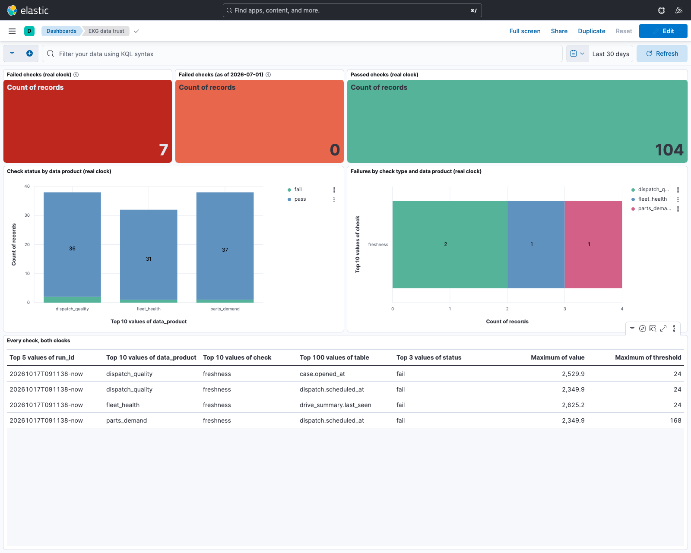

# enterprise-knowledge-graph

Project 2 of 3: a governed knowledge graph over one small enterprise, built so that an
agent gets trusted, provenance-backed context instead of raw tables.

## Why this exists

The enterprise AI data platforms announced across the industry in 2026 share three pieces.
A knowledge graph built from metadata, lineage and query history adds the related tables,
columns and documents to an agent's context when it asks a question. A semantic layer gives
every business term one meaning. And agents get trusted context, scoped by permission and
backed by lineage and quality evidence, instead of whatever a search returns. This repository
is a small working version of all three, on the premise that the model is rarely the next
constraint. The data is.

[services-ops-intelligence](https://github.com/arnavchawla26/services-ops-intelligence)
(Project 1) generates and models the enterprise. This repository is its knowledge layer: a
Neo4j graph of accounts, sites, assets, drives, products, parts, suppliers, cases, dispatches,
technicians and runbooks, and a second layer describing the data itself (tables, columns, data
products, jobs, lineage, query history). On top sit an ontology with one definition per term,
loaded as nodes, measured entity resolution, graph algorithms, text-to-Cypher with a
self-correcting loop, a context-assembly API with per-role permissions, and a data-trust
dashboard. Project 3, `knowledge-agents-pilot`, puts agents on top.

## What is real and what is generated

The same table as Project 1, because the inputs are Project 1's files, read-only.

| Data | Source | Status |
|---|---|---|
| Per-drive telemetry summary, last SMART 5/187/197 values, failure dates | Backblaze Hard Drive Data 2026 Q2 via Project 1's Parquet | Real |
| 30-day failure probability per drive (`Drive.p_fail_30d`) | Project 1's calibrated LightGBM, last scored date 2026-05-31 | Real telemetry, Project 1 model |
| Accounts, sites, assets, products, parts, suppliers, cases, dispatches, technicians, runbooks | Project 1's seeded generator; every asset is a real drive | Generated (assets joined to real; case timing follows real failures) |
| Data products, jobs, lineage rows, 300 query-log rows | Project 1's generator | Generated |
| The real pipeline (`lineage/pipeline.yaml`) | Declared from reading Project 1 and this repository's source; checked by a test | Real |
| Column metadata | Postgres `information_schema` and DuckDB `DESCRIBE` over the real files | Real |
| Ground truth for resolution | Project 1's `truth/` | Generated, reproducible from the seed |

The mess the resolver removes (three spellings, duplicate ids, vendor-prefixed and
lowercased serials) was put there on purpose by rules in Project 1's `docs/MESS_RULES.md`.
That is why resolution can be measured, and why its numbers are a ceiling.

## What is in the graph

Loaded by `make load` in about 50 s: 359,101 Asset and 359,101 Drive nodes, 6,199 Pod,
312 Vault, 81 DriveModel, 701 Site, 335 AccountRecord (239 Account after resolution),
8,281 Case, 4,108 Dispatch, 80 Technician, 30 Part, 8 Supplier, 10 Product, 22 Runbook,
25 Term, and the metadata layer: 81 Table, 777 Column, 12 Job, 3 DataProduct, 300 Query,
with 306 table-level and 590 column-level `DERIVED_FROM` edges. Every entity node has an
`INSTANCE_OF` edge to its Term; every column that carries a glossary meaning has a `MEANS`
edge to it. Daily telemetry stays out of the graph.

## Measured results (2026-10-17)

Every number below was printed by code in this repository and is in `reports/`. The
caveats are part of the result.

### Ontology and semantic layer
`ontology/enterprise.ttl` (SKOS/OWL-lite) holds 25 terms with exactly one definition each
and 18 relationships, rendered to `ontology/glossary.md` and loaded as `:Term` nodes.
`ekg.ontology check` fails on a term with zero or two definitions, and `load` refuses to run
until it passes. The two failure definitions are copied from Project 1's rule F1: telemetry
failure is `failure = 1` on a drive-day; service failure is `case.failure_reported = 1`,
set on `hardware_replaced`. They overlap and do not match, and the glossary says so.

### Entity resolution ([docs/RESOLUTION.md](docs/RESOLUTION.md))
Accounts, scored pairwise on the held-out half of companies, reach precision 1.000, recall
1.000 and canonical-id accuracy 1.000 with thresholds set on the other half. 24 pairs land
in the uncertain band for a reviewer (`reports/uncertain_matches.csv`), 295 if industry and
region are not used as evidence. On assets, 359,101 of 359,101 drives link to their ERP
asset, precision 1.000, recall 1.000, 0 collisions. A first version lost 505 assets because
430 real serials are natively lowercase and 86 really start with `WD-`. The numbers prove
the matcher inverts the generator's mess rules on companies and assets it was not tuned on.
They prove nothing about a real CRM, where variants cross regions and typos hit the first
word.

### Lineage ([docs/LINEAGE.md](docs/LINEAGE.md))
The doc answers two questions in Cypher, with outputs. First, where
`reports/fleet_risk_sites.csv.expected_failures_30d` comes from. The column path runs 66
upstream columns in 5 hops: a per-site sum of the calibrated LightGBM score, from 25
SMART-derived features plus the model, from the telemetry Parquet columns, from the raw
Backblaze CSV columns. The job path is the Fleet Health term, written by `sois.failure_model`
through the serial map. Second, what breaks if `installed_asset` changes: 35 downstream
datasets, 10 jobs, all 3 data products, 182 of the 300 logged queries. Column lineage is
declared per job from its code (590 edges: 214 generated Postgres copies, 53 raw-CSV casts,
323 declared expressions) and tested against Project 1's feature list. It stops at JSON
reports, figures, the model file and the embedding columns, and the expressions are declared
text, not parsed SQL. The doc lists each limit.

### Graph data science ([docs/GDS.md](docs/GDS.md))
Louvain on co-failure (same site, within 14 days) finds 233 communities over 1,306 of
1,522 failed drives, modularity 0.978, 191 inside one vault. On a 48-node part graph,
FAN-80MM, TPM-MOD and NIC-25G top betweenness. 8 of 30 parts are single-sourced. FastRP
embeds 359,101 drives in 16 s.

The lift test is negative. I re-ran Project 1's failure model on its own leak-free split
with the same parameters, three seeds each: baseline PR-AUC 0.1002, plus a vault-id
categorical 0.0623, plus the 32-dim embedding 0.0818. The embedding lowers PR-AUC by 0.018
(seed std 0.002) and recall at 1% by 1.7 points. The baseline reproduces Project 1's 0.0985
at its seed, so the harness is faithful. Location identity overfits 17 training dates. The
graph adds no signal the SMART attributes lack at this horizon. This README does not claim
graph features improve the model.

### Text-to-Cypher ([docs/NL2CYPHER.md](docs/NL2CYPHER.md))
Two question sets with gold Cypher and frozen result hashes. On the 20 one- and
two-hop questions, NVIDIA NIM (`nvidia/nemotron-3-super-120b-a12b`) got 20/20 with one
question fixed on a retry by the loop, Claude (`claude-sonnet-5-5`) 20/20 first try. The 10
multi-hop questions cover three to six hops, a per-group argmax, a NOT pattern, date
arithmetic, a variable-length lineage walk and the semantic layer. Claude got 10/10, two
through the loop. NIM got 5/10, and four of its five misses ran and returned a plausible
wrong row (reversed relationship directions, an invented filter, a regex that never matches).
The loop cannot see those because the database raises no error. The hard set also found two
harness faults, fixed and described in the doc: NIM's reasoning ate an 800-token budget and
returned empty answers that were cached, and the NIM client had no timeout. Responses are
cached on disk and committed, so `make eval` reruns both sets with zero model calls. A guard
refuses writes before execution, as does the server's read access mode. Neo4j Community has
no roles, so the separate reader account is hygiene, not enforcement.

### Context-assembly API ([docs/API.md](docs/API.md))
`POST /context {question, caller_role}` returns terms, tables, columns, runbooks and a graph
neighbourhood filtered by `policy/roles.yaml` (ops_lead, technician, analyst), lists what
was denied, and writes an audit line. For "longest lead time for the failed drives at
account ACC-00009", a technician gets parts and assets but not accounts, prices or the
account's neighbourhood. The ops lead gets all of it. No model call, only keyword matching.

### Data trust ([docs/TRUST.md](docs/TRUST.md), `reports/trust_dashboard.png`)
Each run makes 111 checks against `trust/slas.yaml`, on lake (Project 1's files) and
warehouse (Project 1's Postgres). Against the real clock 104 pass, 7 fail, all freshness:
the quarter ended 2026-06-30, so the telemetry is 2,625 h old against a 24 h SLA and the
support tables are a few months behind theirs. As of 2026-07-01 all 111 pass, 0 fail.
Completeness (row counts, null rates, warehouse-vs-lake row gaps) passes on every table.
Schema drift is 0 because the baseline was captured from the same files, and the test shows
it firing. One earlier run is worth a line. Before Project 1's Postgres was reloaded it held
that repository's 6-row test fixture, and the same job reported 18 failures, every
warehouse-vs-lake check among them. That is what the check is for. The Kibana dashboard is
a committed saved-objects export and a headless screenshot.



## Scope

Every item of the Project 2 design (brainstorm sections 11, 12 and 13c), as done or cut.
Nothing is deferred: what is not here is not planned here.

| Design item | Status | Where |
|---|---|---|
| Ontology: one definition per term, relationships between terms, SKOS/OWL file loaded into the graph | Done: 25 terms (the 18 of 13c plus Account Record, Column, Data Product, Job, Query, Table, Drive), 18 relationships | `ontology/enterprise.ttl`, `ontology/glossary.md`, `:Term` nodes |
| Ontology governance | Done as a test, cut as a process: `ekg.ontology check` blocks the load on a term with zero or two definitions. There is no review board because there is one author | `src/ekg/ontology.py`, `tests/test_ontology.py` |
| Entity resolution with match confidence on the edge and a reviewable uncertain list | Done: scored rules, pairwise precision/recall on a held-out split, 24 uncertain pairs, `SAME_AS` edges with score, method, band | [docs/RESOLUTION.md](docs/RESOLUTION.md), `reports/uncertain_matches.csv` |
| A learned matcher | Cut: the mess is produced by five written rules, so a model would learn the generator, not resolution. The scored rules already invert the rules at 1.000, which is the ceiling the data allows | [docs/RESOLUTION.md](docs/RESOLUTION.md) |
| Lineage graph: Table, Column, DataProduct, Job; "where did this number come from" and "what breaks if this table changes" | Done at table and column level: column paths to the raw CSV, column-level impact; limits listed | [docs/LINEAGE.md](docs/LINEAGE.md) |
| Query history in the graph | Done with generated history: 300 `Query` nodes from Project 1's generator, used by impact. Cut: a real history, because no real user has queried this warehouse | [docs/LINEAGE.md](docs/LINEAGE.md) |
| GDS: communities of assets that fail together, centrality for critical parts, embeddings as features with the measured lift | Done: Louvain/WCC co-failure communities, part betweenness, FastRP embeddings, lift measured and negative (PR-AUC -0.018) | [docs/GDS.md](docs/GDS.md), `reports/gds_*.json` |
| Time-aware co-failure embedding | Cut: edges only among failures before date t leave the embedding null for the 358,000 drives that have not failed, so it cannot rank the fleet. The reason is in the doc | [docs/GDS.md](docs/GDS.md) |
| Text-to-Cypher with a self-correcting loop | Done: two backends, write guard, READ access mode, disk cache; a 20-question set and a 10-question multi-hop set with frozen result hashes | [docs/NL2CYPHER.md](docs/NL2CYPHER.md), `questions/` |
| Context-assembly API: tables, columns, documents and graph neighbourhood the caller may see | Done: `POST /context` with per-role allow-lists, denied-items list, audit log; documents are the runbooks | [docs/API.md](docs/API.md), `policy/roles.yaml` |
| Role enforcement inside Neo4j | Cut: Neo4j Community has users but no roles, so the reader account is hygiene. Enforcement is the guard, the READ access mode and the API's allow-lists | [docs/NL2CYPHER.md](docs/NL2CYPHER.md) |
| Data-trust dashboard in Kibana: completeness, freshness, schema drift per data product against SLAs | Done: 111 checks per run, both clocks, saved objects and a headless screenshot | [docs/TRUST.md](docs/TRUST.md), `reports/trust_dashboard.png` |

## How to run

You need Python 3.13, [uv](https://docs.astral.sh/uv/), Docker, and a checkout of
services-ops-intelligence next to this one with its Parquet, enterprise CSVs, truth and
reports built (`make load generate analyses` there). The three containers need about 6 GB of
RAM (each JVM capped at 1 GB).

```
cp .env.example .env                     # Neo4j and Elasticsearch settings; model keys optional
uv sync                                  # pinned environment
uv run pytest                            # 65 tests on fixtures; live tests skip without Neo4j
make up                                  # Neo4j 5.26 community (APOC, GDS), Elasticsearch 8.17, Kibana 8.17
make load                                # ontology check + render, graph load (about a minute)
make resolve                             # entity resolution, metrics, review list, SAME_AS edges
make lineage                             # metadata layer and the two documented queries
make gds                                 # communities, centrality, embeddings, lift test (about 3 minutes)
make eval                                # text-to-Cypher eval from cache (no keys needed)
make trust                               # trust checks, both clocks, into Elasticsearch
make screenshot                          # import the Kibana dashboard and capture it
make api                                 # context API on :8008
```

`ekg.load --postgres` reads the drive summary from Project 1's Postgres instead of Parquet
(same 359,101 rows, checked). Parquet stays the default because it needs no database.
`make eval-live` calls the model backends for uncached prompts (`NVIDIA_API_KEY`,
`ANTHROPIC_API_KEY`). The Kibana screenshot needs `uv run playwright install chromium` once.

## Layout

```
ontology/     enterprise.ttl (SKOS/OWL-lite), glossary.md (rendered)
lineage/      pipeline.yaml (the real pipeline and its column lineage, declared and tested)
policy/       roles.yaml (per-role allow-lists for the API)
questions/    eval.yaml (20 questions), hard.yaml (10 multi-hop questions); gold Cypher, frozen result hashes
trust/        slas.yaml, schema_baseline.json
kibana/       trust_dashboard.ndjson (saved objects)
cache/        nl2cypher model responses (committed; reruns are free)
src/ekg/      config, graph, ontology, load, resolve, lineage, gds, nl2cypher, api, trust
scripts/      screenshot_kibana.py
reports/      metrics JSON/CSV, communities, centrality, eval, trust results, dashboard PNG
docs/         RESOLUTION, LINEAGE, GDS, NL2CYPHER, API, TRUST
tests/        65 tests on hand-made fixtures (6 assets, 8 account rows, every mess rule once, the real column names)
```

## Honesty

Commit dates are real. Nothing is backdated. Every number in this README was printed by
code in this repository on the stated date and lives in `reports/`. Negative results
(the embedding lift, the stale freshness, the stale-warehouse run) are reported as measured.
The generated data is labelled generated everywhere it appears. I never modified Project 1's
repository or database.

## License

MIT, see [LICENSE](LICENSE). The Backblaze data is subject to Backblaze's terms, not this
license.
